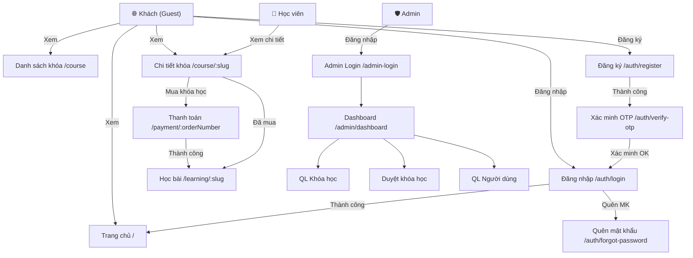
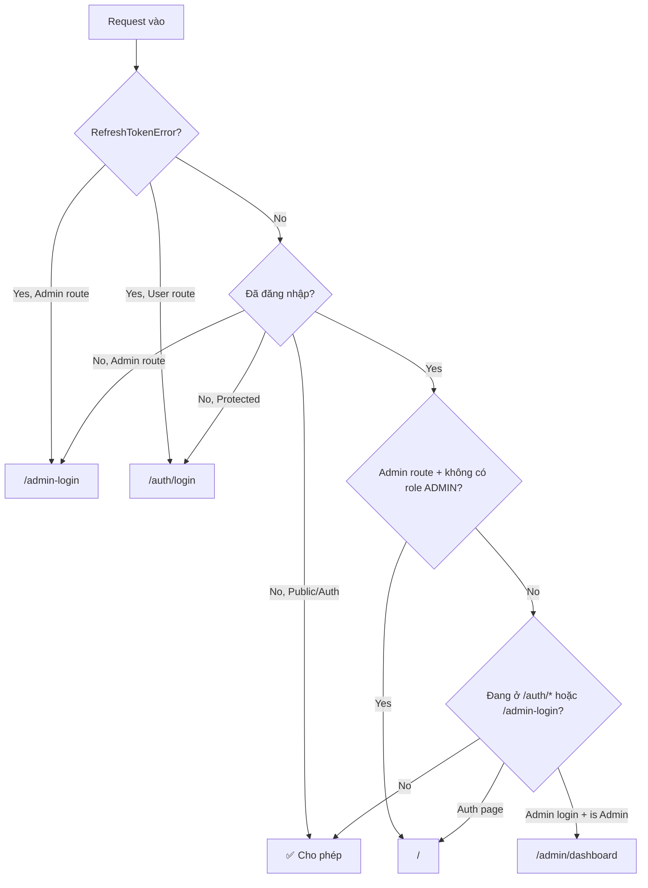
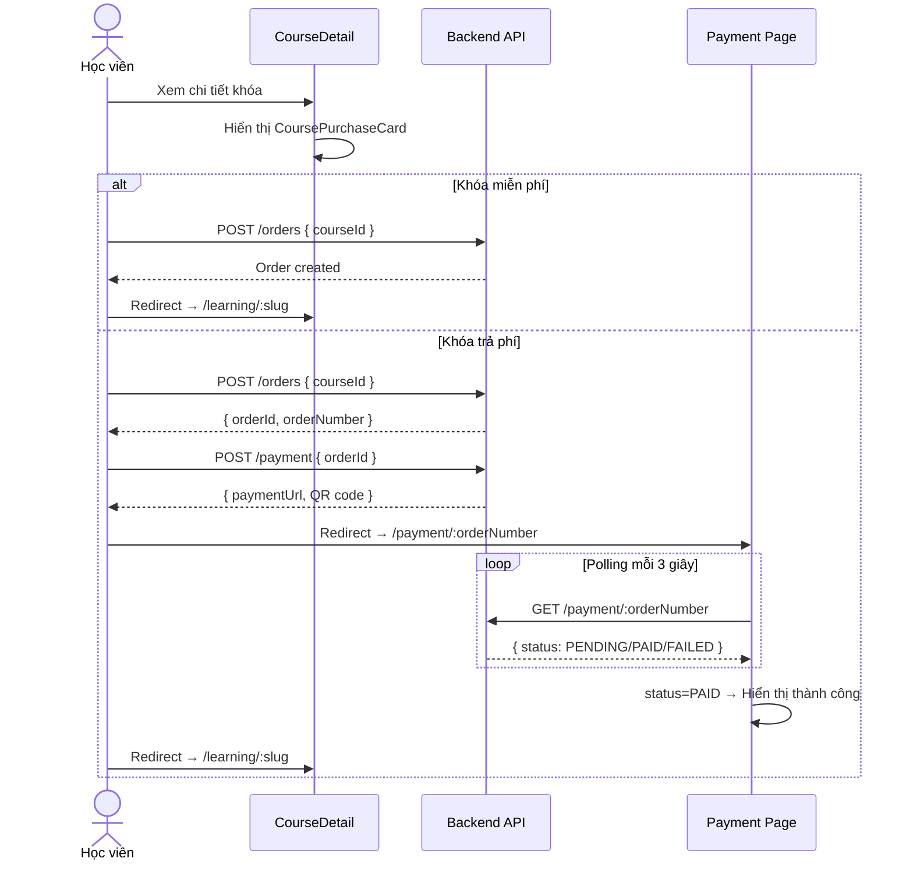
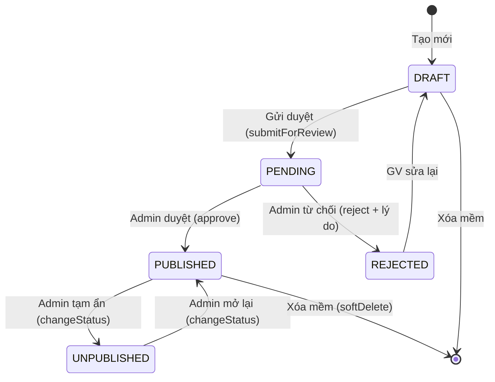

# 📘 NevaGiveUp — Tài liệu Front-end Toàn diện

> **Phiên bản**: 1.0 · **Ngày cập nhật**: 2026-10-25
> **Framework**: Next.js 16 (App Router) · React 19 · TailwindCSS 4 · shadcn/ui (radix-nova)
> **Repo FE**: [`Front-end/`](file:///home/nbt2308/nbt/Web/NevaGiveUp/Front-end)

---

## Mục lục

1. [Nguồn 1 — UI Design System](#nguồn-1--ui-design-system)
2. [Nguồn 2 — Danh sách toàn bộ trang (Page Inventory)](#nguồn-2--danh-sách-toàn-bộ-trang-page-inventory)
3. [Nguồn 3 — User Flow và nghiệp vụ](#nguồn-3--user-flow-và-nghiệp-vụ)
4. [Nguồn 4 — Cấu trúc dự án và API hiện có](#nguồn-4--cấu-trúc-dự-án-và-api-hiện-có)

---

## Nguồn 1 — UI Design System

### 1.1 Hệ màu sắc (Color System)

Dự án sử dụng **CSS Custom Properties** với hệ màu `oklch`, hỗ trợ **Light Mode** và **Dark Mode**.

| Token | Light Mode | Dark Mode | Mô tả |
|---|---|---|---|
| `--background` | `oklch(1 0 0)` (trắng) | `oklch(0.145 0 0)` (gần đen) | Nền chính |
| `--foreground` | `oklch(0.145 0 0)` (đen) | `oklch(0.985 0 0)` (trắng) | Chữ chính |
| `--primary` | `oklch(0.205 0 0)` (đen đậm) | `oklch(0.922 0 0)` (gần trắng) | Màu chủ đạo |
| `--primary-foreground` | `oklch(0.985 0 0)` | `oklch(0.205 0 0)` | Chữ trên primary |
| `--secondary` | `oklch(0.97 0 0)` | `oklch(0.269 0 0)` | Màu phụ |
| `--muted` | `oklch(0.97 0 0)` | `oklch(0.269 0 0)` | Nền mờ |
| `--muted-foreground` | `oklch(0.556 0 0)` | `oklch(0.708 0 0)` | Chữ mờ |
| `--accent` | `oklch(0.97 0 0)` | `oklch(0.269 0 0)` | Nền accent |
| `--destructive` | `oklch(0.577 0.245 27.325)` | `oklch(0.704 0.191 22.216)` | Đỏ cảnh báo |
| `--border` | `oklch(0.922 0 0)` | `oklch(1 0 0 / 10%)` | Viền |
| `--input` | `oklch(0.922 0 0)` | `oklch(1 0 0 / 15%)` | Viền input |
| `--ring` | `oklch(0.708 0 0)` | `oklch(0.556 0 0)` | Focus ring |
| `--card` | `oklch(1 0 0)` | `oklch(0.205 0 0)` | Nền card |

**Sidebar riêng (Dark mode)**:
- `--sidebar-primary`: `oklch(0.488 0.243 264.376)` — tím xanh, accent nổi bật trong sidebar dark.

**Màu bổ sung trong component**:
- **Emerald** (`bg-emerald-500`): Tag "Miễn phí", badge trạng thái "Đã xuất bản"
- **Amber** (`text-amber-400`): Rating sao, badge "Chờ duyệt"
- **Rose** (`bg-rose-500/10`): Badge giảm giá, trạng thái "Bị từ chối"
- **Purple**: Badge "Tạm ẩn"
- **Blue** (`bg-blue-600`): Social link Facebook
- **Zinc** (`bg-zinc-600`): Social link Github

> [!NOTE]
> Phong cách chung: **Neutral/Monochrome** (đen-trắng-xám) cho hệ thống chính, kết hợp **semantic color** cho trạng thái. Giao diện tối giản, "editorial" style.

### 1.2 Typography

| Thuộc tính | Giá trị |
|---|---|
| **Font chính** | `'Outfit'`, fallback: `'Segoe UI', Tahoma, Geneva, Verdana, sans-serif` |
| **Font heading** | Dùng chung `--font-sans` (Geist Sans) |
| **Font mono** | Geist Mono (`--font-geist-mono`) |
| **Logo** | `font-mono font-bold` — Monospace đậm |
| **Antialiasing** | `antialiased` trên `<html>` |

**Kích thước chữ theo component**:

| Ngữ cảnh | Size | Weight |
|---|---|---|
| Logo brand text | `text-xl` | `font-bold` |
| Card title (sm) | `text-sm` | `font-bold` |
| Card title (lg) | `text-lg` | `font-bold` |
| Card tag | `text-[10px]` / `text-xs` | `font-medium` |
| Card stat | `text-[10px]` / `text-xs` | — |
| Card price | `text-xs` / `text-base` | `font-extrabold` |
| KPI Card value | `text-3xl` | `font-extrabold` |
| KPI Card label | `text-xs` | `font-semibold uppercase tracking-wider` |
| Nav link | `text-sm` | — |
| Footer section title | `text-lg` | `font-bold` |
| Tiptap H1 | `text-2xl` | `font-bold` |
| Tiptap H2 | `text-xl` | `font-bold` |
| Tiptap H3 | `text-lg` | `font-semibold` |

### 1.3 Khoảng cách (Spacing)

| Thành phần | Spacing |
|---|---|
| Container | `container mx-auto px-6 md:px-10` |
| Header height | `h-16` |
| Admin main padding | `p-6` |
| Learning layout padding | `p-4 md:p-6` |
| Card padding (sm) | `p-3` |
| Card padding (lg) | `p-4` |
| KPI Card padding | `p-5` |
| Sidebar width | `16rem` (256px) |
| Sidebar collapsed | `3rem` (48px) |
| Gap giữa sections | `gap-6`, `gap-12`, `gap-16` |

### 1.4 Bo góc (Border Radius)

| Token | Giá trị |
|---|---|
| `--radius` (gốc) | `0.625rem` (10px) |
| `--radius-sm` | `0.375rem` (6px) |
| `--radius-md` | `0.5rem` (8px) |
| `--radius-lg` | `0.625rem` (10px) |
| `--radius-xl` | `0.875rem` (14px) |
| `--radius-2xl` | `1.125rem` (18px) |
| Button | `rounded-lg` |
| Input | `rounded-lg` |
| Card | `rounded-lg` |
| KPI Card | `rounded-2xl` |
| Logo box | `rounded-lg` |
| Badge status | `rounded-full` |
| Badge trên card | `rounded-md` |

### 1.5 Button

Sử dụng **class-variance-authority (CVA)** với các variant:

| Variant | Style |
|---|---|
| `default` | `bg-primary text-primary-foreground hover:bg-primary/80` |
| `outline` | `border-border bg-background hover:bg-muted` |
| `secondary` | `bg-secondary text-secondary-foreground` |
| `ghost` | `hover:bg-muted hover:text-foreground` |
| `destructive` | `bg-destructive/10 text-destructive hover:bg-destructive/20` |
| `link` | `text-primary underline-offset-4 hover:underline` |

**Sizes**: `xs` (h-6), `sm` (h-7), `default` (h-8), `lg` (h-9), `icon` (size-8), `icon-xs/sm/lg`

**Focus**: `focus-visible:border-ring focus-visible:ring-3 focus-visible:ring-ring/50`
**Active**: `active:translate-y-px`

### 1.6 Input

- Height: `h-10`
- Border: `border-input rounded-lg`
- Focus: `focus-visible:border-ring focus-visible:ring-3 focus-visible:ring-ring/50`
- Disabled: `disabled:opacity-50 disabled:bg-input/50`
- Error: `aria-invalid:border-destructive aria-invalid:ring-destructive/20`
- Dark: `dark:bg-input/30`

### 1.7 Card Course

Hai kích thước `sm` và `lg`:
- Border: `border-border/60 rounded-lg`
- Hover: `hover:border-primary/40 hover:shadow-lg hover:-translate-y-0.5` (sm) / `hover:shadow-xl hover:-translate-y-1` (lg)
- Image: `aspect-video`, `group-hover:scale-105 transition-all duration-500`
- Badge overlay: `bg-background/80 backdrop-blur-md`

### 1.8 Sidebar (Admin)

- Component: shadcn/ui `<Sidebar>` với `collapsible="icon"`
- Width: `16rem` → `3rem` (collapsed)
- Có 3 group: **Tổng quan**, **Quản lý khóa học** (4 items), **Hệ thống** (3 items)
- Footer: `<NavUser>` với avatar, tên, email

### 1.9 Header

**Client Header**:
- Sticky: `sticky top-0 z-50`
- Background: `bg-white/80 backdrop-blur-md` / `dark:bg-zinc-950/80`
- Navigation: `<NavigationMenu>` shadcn/ui
- Active indicator: underline `h-[2px]` animate `scale-x` origin-left
- Mobile: `<MobileNavigation>` (Sheet component)
- Actions: `<ModeToggle>` + `<DropdownMenuAvatar>` hoặc `<LoginButton>`

**Admin Header**:
- Border bottom: `border-b shadow-sm`
- Left: `<SidebarTrigger>`, Right: `<ModeToggle>`

### 1.10 Trạng thái Loading / Error / Empty

| Trạng thái | Cách xử lý |
|---|---|
| **Loading (Skeleton)** | `animate-pulse` với `bg-slate-200 dark:bg-slate-800` cho video placeholder; `<Skeleton>` component cho KPI cards, danh sách |
| **Loading (Data)** | React Query `isPending` flags, hiển thị skeleton tương ứng |
| **Error (Global)** | `QueryCache.onError` → `toast.error()` qua Sonner; 401 → tự động signOut |
| **Error (Auth)** | Custom error classes: `UnauthorizedError`, `InActiveAccountError`, `InvalidParameters`, `ConflictAccountError` |
| **Error Page** | Route `/error/page.tsx` — trang lỗi chung NextAuth |
| **Empty** | Chưa có component empty state chung (cần bổ sung) |
| **Toast** | Sonner `<Toaster position="top-right" richColors />` |

### 1.11 Thư viện UI bổ sung

| Thư viện | Vai trò |
|---|---|
| **shadcn/ui** (radix-nova style) | Component system chính (33 UI components) |
| **Ant Design** (`antd` + `@ant-design/nextjs-registry`) | Có cài nhưng ít dùng trực tiếp |
| **Lucide React** | Icon library |
| **Motion** (framer-motion) | Animation |
| **Tiptap** | Rich text editor (9 extensions) |
| **Recharts** | Biểu đồ (dự kiến cho Dashboard) |
| **react-youtube** | YouTube video player |
| **Sonner** | Toast notification |

---

## Nguồn 2 — Danh sách toàn bộ trang (Page Inventory)

### 2.1 Tổng quan trạng thái

| Trạng thái | Ký hiệu | Số lượng | Mô tả |
|---|---|---|---|
| ✅ **Đã hoàn thành** | ✅ | 18 | Đã có code UI, layout và routing hoạt động |
| 🔨 **Đang thiết kế / WIP** | 🔨 | 5 | Đã có route/file nhưng UI sơ khai hoặc chưa gắn API |
| 📋 **Chưa thiết kế (dự kiến bổ sung)** | 📋 | 16 | Đã có trong kiến trúc nghiệp vụ, đang lên kế hoạch phát triển |

---

### 2.2 Trang cho Khách & Học viên (Client)

| # | Route | Trang | Trạng thái | Ghi chú & Tính năng |
|---|---|---|---|---|
| 1 | `/` | Trang chủ | ✅ | `<HomePage>` — Hero banner, Feature Courses, Categories, Giới thiệu |
| 2 | `/course` | Danh sách khóa học | ✅ | `<CoursePage>` — Filter đa tiêu chí, search, phân trang, sort |
| 3 | `/course/[slug]` | Chi tiết khóa học | ✅ | `<CourseDetail>` — 12 sub-components, curriculum preview, review, SSR metadata |
| 4 | `/learning/[slug]` | Không gian học tập (LMS) | ✅ | `<LearningLayout>` — Video player (YouTube), sidebar bài học, note, progress tracking |
| 5 | `/payment/[orderNumber]` | Cổng thanh toán | ✅ | `<Payment>` — QR code chuyển khoản, đếm ngược thời gian, polling kiểm tra trạng thái |
| 6 | `/auth/login` | Đăng nhập | ✅ | Credentials (email/password) + Google OAuth + GitHub OAuth |
| 7 | `/auth/register` | Đăng ký | ✅ | Form validation Zod + auto redirect xác minh OTP |
| 8 | `/auth/verify-otp` | Xác minh OTP | ✅ | 6-digit OTP input + resend countdown timer |
| 9 | `/auth/forgot-password` | Quên mật khẩu | ✅ | Quy trình 3 bước: Nhập email → OTP → Tạo mật khẩu mới |
| 10 | `/profile` | Hồ sơ cá nhân | 📋 | Cập nhật avatar, bio, thông tin liên hệ, đổi mật khẩu |
| 11 | `/my-courses` | Khóa học của tôi | 📋 | Danh sách các khóa học đã đăng ký kèm thanh tiến độ hoàn thành |
| 12 | `/my-certificates` | **Chứng chỉ của tôi (Certificates)** | 📋 | Xem danh sách các chứng chỉ đã được cấp, tải PDF, liên kết xác minh Blockchain |
| 13 | `/orders` / `/my-orders` | **Lịch sử giao dịch (Order/Payment History)** | 📋 | Danh sách hóa đơn, mã đơn hàng, ngày thanh toán, số tiền, trạng thái giao dịch (PAID/PENDING/REFUNDED) |
| 14 | `/posts` | Bài viết / Blog | 📋 | Đã có trong menu header, chưa có giao diện page |
| 15 | `/tags` | Danh mục Tags | 📋 | Đã có trong menu header, chưa có giao diện page |
| 16 | `/about` | Về chúng tôi | 📋 | Đã có link navigation, chưa có giao diện page |
| 17 | `/terms` | Điều khoản dịch vụ | 📋 | Đã có link footer, chưa có giao diện page |
| 18 | `/privacy` | Chính sách bảo mật | 📋 | Đã có link footer, chưa có giao diện page |

---

### 2.3 Phân hệ Trợ lý Học tập AI (AI Learning Suite)

> [!NOTE]
> Các tính năng AI được tích hợp trực tiếp vào không gian học tập `/learning/[slug]` dưới dạng tab/drawer/floating panel để tối ưu trải nghiệm học viên không bị gián đoạn.

| # | Phân hệ / Tính năng | Vị trí / Route | Trạng thái | Nghiệp vụ & Mô tả chi tiết |
|---|---|---|---|---|
| 1 | **AI Summary** (Tóm tắt bài học) | `/learning/[slug]` *(Tab AI Summary)* | 📋 | Trích xuất nội dung transcript video / tài liệu bài giảng, tóm tắt các ý chính (key takeaways), thuật ngữ quan trọng và mindmap ngắn gọn bằng GenAI. |
| 2 | **AI Quiz Generator** (Tự sinh câu hỏi ôn tập) | `/learning/[slug]` *(Panel Ôn tập AI)* | 📋 | Tự động tạo bộ câu hỏi trắc nghiệm (3–5 câu) sau mỗi bài học dựa trên nội dung video để học viên tự kiểm tra độ hiểu bài ngay lập tức. |
| 3 | **AI Q&A Trong Quá Trình Học** (Trợ lý hỏi đáp 24/7) | `/learning/[slug]` *(Floating Widget / Sidebar Drawer)* | 📋 | Chatbot thông minh ngữ cảnh (RAG): Giải đáp thắc mắc liên quan trực tiếp đến timestamp video đang xem hoặc code snippet, gợi ý giải bài tập. |
| 4 | **AI Course Assistant** (Hỗ trợ Giảng viên tạo đề) | `/instructor/courses/[id]/curriculum` | 📋 | Trợ lý hỗ trợ giảng viên tự động sinh ngân hàng câu hỏi quiz và outline bài giảng theo chủ đề. |

---

### 2.4 Phân hệ Blockchain & Xác minh Chứng chỉ (Blockchain & Certificate Verification)

| # | Route | Trang | Trạng thái | Nghiệp vụ & Mô tả chi tiết |
|---|---|---|---|---|
| 1 | `/certificate/[id]` | **Xem thông tin chứng chỉ** | 📋 | Trang public hiển thị chứng chỉ hoàn thành khóa học: Tên học viên, Tên khóa học, Giảng viên, Ngày cấp, Mã chứng chỉ (Certificate ID), Con dấu số và nút Chia sẻ (LinkedIn, Facebook). |
| 2 | `/certificate/verify` hoặc `/verify-certificate/[hash]` | **Xác minh chứng chỉ Blockchain (Certificate Verification)** | 📋 | Trang tra cứu và xác minh tính toàn vẹn của chứng chỉ trên mạng Blockchain: Hiển thị Transaction Hash, Smart Contract Address, Timestamp block, Issuer Address, kiểm tra xem chứng chỉ có bị thu hồi (revoked) hay không. |
| 3 | `/admin/certificates` | **Quản lý Chứng chỉ hệ thống (Admin)** | 📋 | Danh sách toàn bộ chứng chỉ đã phát hành, log giao dịch blockchain, thu hồi chứng chỉ vi phạm. |

---

### 2.5 Trang cho Giảng viên (Instructor Portal)

> [!IMPORTANT]
> Cần xây dựng Instructor Layout riêng (`/src/app/instructor/layout.tsx`) với Sidebar menu chuyên dụng: Dashboard, Khóa học của tôi, Quản lý học viên, Doanh thu & Rút tiền.

| # | Route | Trang | Trạng thái | Ghi chú & Nghiệp vụ |
|---|---|---|---|---|
| 1 | `/instructor/dashboard` | **Instructor Dashboard** | 📋 | Tổng quan chỉ số: Doanh thu tháng, tổng học viên, rating trung bình, biểu đồ tăng trưởng doanh thu/lượt đăng ký mới. |
| 2 | `/instructor/courses` | **My Courses (Khóa học của tôi)** | 🔨 | Bảng danh sách khóa học của GV với bộ lọc (DRAFT, PENDING, PUBLISHED, REJECTED), thống kê số học viên & doanh thu từng khóa. |
| 3 | `/instructor/courses/new` hoặc `.../[courseId]/edit` | **Course Editor (Trình tạo/sửa khóa học)** | 📋 | Form đa bước (Multi-step wizard): Thông tin cơ bản, ảnh thumbnail/video intro, danh mục/tags, định giá (Free/Paid), mục tiêu đầu ra và yêu cầu tiên quyết. |
| 4 | `/instructor/courses/[courseId]/curriculum` | **Curriculum Builder (Quản lý chương trình)** | 🔨 | Trình dựng cây chương trình học: Thêm/sửa/xóa Section, Lesson, đính kèm video, bài tập, Quiz và tài liệu đính kèm (Drag-and-drop sorting). |
| 5 | `/instructor/students` hoặc `.../[courseId]/students` | **Student Management (Quản lý học viên)** | 📋 | Danh sách học viên tham gia từng khóa, tỷ lệ hoàn thành (progress %), ngày tham gia, lịch sử câu hỏi Q&A và tương tác. |
| 6 | `/instructor/revenue` | **Revenue (Doanh thu & Rút tiền)** | 📋 | Thống kê dòng tiền, số dư khả dụng, tỷ lệ phân chia doanh thu (platform split), lịch sử thanh toán định kỳ và form yêu cầu rút tiền (Payout request). |

---

### 2.6 Trang Quản lý Đơn hàng & Giao dịch (Order & Payment History)

| # | Route | Trang | Trạng thái | Phân quyền & Chức năng |
|---|---|---|---|---|
| 1 | `/orders` hoặc `/my-orders` | **Lịch sử đơn hàng cá nhân (Order/Payment History)** | 📋 | **Học viên**: Xem danh sách các khóa học đã mua, trạng thái đơn hàng (PENDING, PAID, CANCELLED, REFUNDED), biên lai điện tử và nút thanh toán tiếp nếu đơn chưa hoàn tất. |
| 2 | `/admin/orders` | **Quản lý Đơn hàng toàn hệ thống** | 📋 | **Admin**: Quản lý toàn bộ giao dịch, tra cứu mã đơn hàng, đối soát dòng tiền cổng thanh toán (VietQR/Momo/VNPAY), xử lý hoàn tiền (Refund). |

---

### 2.7 Trang Quản trị viên (Admin Portal)

| # | Route | Trang | Trạng thái | Ghi chú |
|---|---|---|---|---|
| 1 | `/admin-login` | Đăng nhập Admin | ✅ | Luồng đăng nhập riêng biệt có kiểm tra quyền Admin/SuperAdmin |
| 2 | `/admin/dashboard` | Dashboard tổng quan | 🔨 | Khung trang đã có, cần tích hợp biểu đồ Recharts (doanh thu, người dùng mới, khóa học mới) |
| 3 | `/admin/courses` | Quản lý khóa học | ✅ | DataTable phân trang, tìm kiếm, modal Create/Update/View khóa học |
| 4 | `/admin/courses/[courseId]/curriculum` | Quản lý chương trình giảng dạy | ✅ | Quản lý Sections, Lessons, tích hợp upload video YouTube/Cloud |
| 5 | `/admin/moderation` | Kiểm duyệt khóa học | ✅ | KPI cards, duyệt xuất bản (PUBLISHED), từ chối duyệt kèm lý do (REJECTED) |
| 6 | `/admin/tags` | Quản lý Tags | ✅ | CRUD thẻ phân loại + bulk delete actions |
| 7 | `/admin/categories` | Quản lý danh mục | ✅ | CRUD danh mục khóa học cha - con |
| 8 | `/admin/users` | Quản lý người dùng | ✅ | Danh sách tài khoản, trạng thái Active/Inactive, đổi vai trò |
| 9 | `/admin/roles` | Quản lý vai trò (RBAC) | ✅ | CRUD nhóm vai trò và gán nhóm quyền |
| 10 | `/admin/permissions` | Danh sách quyền hệ thống | ✅ | Bảng tra cứu danh sách quyền hạn module-based |

---

### 2.8 Trang hệ thống & Trang dự kiến bổ sung

| # | Route / Tên trang | Đối tượng | Trạng thái | Mức ưu tiên |
|---|---|---|---|---|
| 1 | `/error` (Error page) | Tất cả | ✅ | NextAuth error handler |
| 2 | `/api/auth/[...nextauth]` | Hệ thống | ✅ | NextAuth API handler |
| 3 | `/404` (Custom Not Found) | Tất cả | 📋 | 🟢 Thấp |
| 4 | `Instructor Layout & Sidebar` | Giảng viên | 📋 | 🔴 Cao (Bắt buộc để kích hoạt Instructor portal) |

---

## Nguồn 3 — User Flow và Nghiệp vụ

### 3.1 Tổng quan luồng người dùng



### 3.2 Luồng Xác thực (Authentication Flow)

#### 3.2.1 Đăng ký tài khoản
```
1. Khách → /auth/register
2. Nhập: name, email, password, confirmPassword
3. Gọi POST /auth/register
4. Thành công → redirect /auth/verify-otp?verifyToken=xxx
5. Nhập mã OTP 6 số
6. Gọi POST /auth/activate { verifyToken, codeId }
7. Thành công → redirect /auth/login
```

#### 3.2.2 Đăng nhập (3 phương thức)
| Phương thức | Provider ID | API Endpoint |
|---|---|---|
| Email + Password | `credentials` | `POST /auth/login` |
| Google OAuth | `google` | `POST /auth/oauth` |
| GitHub OAuth | `github` | `POST /auth/oauth` |

**Xử lý sau đăng nhập**:
1. Nhận `access_token` + `refresh_token`
2. Gọi `GET /auth/me` để lấy profile (id, name, email, roles, avatar)
3. Lưu vào JWT token (NextAuth)
4. Token hết hạn → auto refresh với `POST /auth/refresh` (có lock mechanism, buffer 60s)
5. Refresh thất bại → set `error: "RefreshTokenError"` → redirect login

#### 3.2.3 Đăng nhập Admin
```
1. Admin → /admin-login (tách riêng)
2. Gọi POST /auth/admin-login (cùng credentials)
3. Backend kiểm tra role ADMIN
4. Thành công → redirect /admin/dashboard
```

#### 3.2.4 Quên mật khẩu (3 bước)
```
Bước 1: Nhập email → POST /auth/send-reset-password-otp
Bước 2: Nhập OTP → POST /auth/verify-reset-password-otp
Bước 3: Nhập mật khẩu mới → POST /auth/reset-password
```

### 3.3 Middleware & Phân quyền (Route Protection)

File [`proxy.ts`](file:///home/nbt2308/nbt/Web/NevaGiveUp/Front-end/src/proxy.ts) xử lý middleware:



**Roles hệ thống** (`SYSTEM_ROLES`):
| Role | Giá trị | Quyền truy cập |
|---|---|---|
| `ADMIN` | `"ADMIN"` | Toàn bộ `/admin/*` |
| `INSTRUCTOR` | `"INSTRUCTOR"` | `/instructor/*` (đang phát triển) |
| `STUDENT` | `"STUDENT"` | `/learning/*`, `/payment/*` |

**Public routes** (không cần đăng nhập): `/course`, `/course/[slug]`

### 3.4 Luồng Mua khóa học



**Payment Status**: `PENDING` → `PAID` | `FAILED` | `EXPIRED` | `REFUNDED`
- Polling dừng khi status ở trạng thái cuối (`PAID`, `FAILED`, `EXPIRED`, `REFUNDED`)
- Interval: 3 giây
- Không poll khi tab ẩn (`refetchIntervalInBackground: false`)

### 3.5 Luồng Học bài (Learning Flow)

#### Điều kiện vào trang Learning
```typescript
// /learning/[slug]/page.tsx
const course = await CourseService.getCourseBySlugServer(slug);
if (!course?.isEnrolled) {
    redirect(`/course/${slug}`);  // Chưa đăng ký → redirect về chi tiết
}
```

#### Luồng học
```
1. Kiểm tra isEnrolled (server-side)
2. Load courseForLearner (thông tin khóa) + curriculum (sections + lessons)
3. Resume bài đang học:
   - Nếu có lastLessonId → hiển thị bài đó
   - Nếu không → hiển thị bài chưa hoàn thành đầu tiên
   - Nếu đã hoàn thành tất cả → hiển thị bài cuối
4. Load lessonContent (video, nội dung, tài nguyên)
5. Xem video YouTube (react-youtube player)
6. Auto-save progress (position) khi xem video
7. Đánh dấu hoàn thành / bỏ hoàn thành bài học
8. Chuyển bài qua sidebar hoặc navigation prev/next
```

#### Dữ liệu Learning

| API | Phương thức | Mô tả |
|---|---|---|
| `/learning/courses/:slug` | GET | Thông tin khóa học cho learner |
| `/learning/courses/:slug/curriculum` | GET | Danh sách sections + lessons + trạng thái hoàn thành |
| `/learning/courses/:slug/lessons/:id` | GET | Nội dung bài (video, text, tài nguyên, navigation) |
| `/learning/courses/:slug/lessons/:id/complete` | POST | Đánh dấu hoàn thành |
| `/learning/courses/:slug/lessons/:id/uncomplete` | POST | Bỏ đánh dấu hoàn thành |
| `/learning/courses/:slug/lessons/:id/progress` | PUT | Lưu tiến trình video (position) |
| `/learning/lessons/:id/resources/:rid/download` | GET | Tải tài nguyên đính kèm |

### 3.6 Luồng Quản lý Khóa học (Admin/Instructor)



**Các hành động quản lý**:

| Hành động | API | Người thực hiện |
|---|---|---|
| Tạo khóa học | `POST /courses` | Admin / Instructor |
| Cập nhật khóa học | `PATCH /courses/:id` | Admin / Instructor |
| Gửi duyệt | `POST /courses/submit` | Instructor |
| Duyệt | `POST /courses/approve` | Admin |
| Từ chối (kèm lý do) | `POST /courses/reject` | Admin |
| Đổi trạng thái | `POST /courses/change-status` | Admin |
| Xóa mềm | `DELETE /courses/soft/:id` | Admin |
| Xóa hàng loạt | `POST /courses/bulk-delete` | Admin |

### 3.7 Luồng Duyệt Khóa học (Moderation)

```
1. Admin → /admin/moderation
2. Xem KPI cards (GET /courses/moderation/kpis)
3. Xem danh sách chờ duyệt (GET /courses/moderation/list)
4. Click vào khóa → Mở modal review (GET /courses/moderation/:id/review)
5. Quyết định:
   a. Duyệt → POST /courses/approve { id }
   b. Từ chối → Mở modal nhập lý do → POST /courses/reject { id, reason_rejected, sendEmail? }
```

### 3.8 Cấp Chứng chỉ

> [!IMPORTANT]
> **Chưa implement**. Hiện tại hệ thống theo dõi `completedLesson` / `totalLesson` nhưng chưa có:
> - Logic xác định "hoàn thành khóa học" (100% bài học)
> - API tạo/cấp chứng chỉ
> - Trang xem/download chứng chỉ
> - Thiết kế template chứng chỉ

---

## Nguồn 4 — Cấu trúc Dự án và API Hiện có

### 4.1 Cấu trúc thư mục

```
Front-end/
├── src/
│   ├── app/                          # Next.js App Router
│   │   ├── (client)/                 # Route group — Client pages
│   │   │   ├── layout.tsx            # Header + Footer wrapper
│   │   │   ├── page.tsx              # / (Trang chủ)
│   │   │   ├── auth/
│   │   │   │   ├── login/page.tsx
│   │   │   │   ├── register/page.tsx
│   │   │   │   ├── verify-otp/page.tsx
│   │   │   │   └── forgot-password/page.tsx
│   │   │   ├── course/
│   │   │   │   ├── page.tsx          # Danh sách khóa học
│   │   │   │   └── [slug]/page.tsx   # Chi tiết khóa học (SSR)
│   │   │   ├── learning/
│   │   │   │   └── [slug]/page.tsx   # Trang học (SSR + guard)
│   │   │   └── payment/
│   │   │       └── [orderNumber]/page.tsx
│   │   ├── admin/                    # Admin panel
│   │   │   ├── layout.tsx            # Sidebar + Header wrapper
│   │   │   ├── dashboard/page.tsx
│   │   │   ├── courses/
│   │   │   │   ├── page.tsx
│   │   │   │   └── [courseId]/curriculum/page.tsx
│   │   │   ├── moderation/page.tsx
│   │   │   ├── tags/page.tsx
│   │   │   ├── categories/page.tsx
│   │   │   ├── users/page.tsx
│   │   │   ├── roles/page.tsx
│   │   │   └── permissions/page.tsx
│   │   ├── admin-login/page.tsx      # Standalone admin login
│   │   ├── instructor/              # Instructor panel (WIP)
│   │   │   ├── layout.tsx           # Rỗng
│   │   │   └── courses/
│   │   │       ├── page.tsx
│   │   │       └── [courseId]/curriculum/  # Rỗng
│   │   ├── api/auth/[...nextauth]/   # NextAuth API handlers
│   │   ├── error/page.tsx
│   │   ├── globals.css
│   │   ├── layout.tsx                # Root layout
│   │   └── providers.tsx             # React Query + DevTools
│   │
│   ├── components/
│   │   ├── ui/                       # 33 shadcn/ui components
│   │   │   ├── accordion.tsx
│   │   │   ├── alert-dialog.tsx
│   │   │   ├── button.tsx
│   │   │   ├── combobox.tsx
│   │   │   ├── data-table.tsx
│   │   │   ├── dialog.tsx
│   │   │   ├── dropdown-menu.tsx
│   │   │   ├── field.tsx
│   │   │   ├── input.tsx
│   │   │   ├── logo.tsx             # Custom Logo component
│   │   │   ├── navigation-menu.tsx
│   │   │   ├── select.tsx
│   │   │   ├── sidebar.tsx
│   │   │   ├── skeleton.tsx
│   │   │   ├── sonner.tsx
│   │   │   ├── tabs.tsx
│   │   │   └── ... (tổng 33 file)
│   │   ├── shared/                   # 22 shared components
│   │   │   ├── cardCourse.tsx        # Card khóa học (sm/lg)
│   │   │   ├── courseStatus.tsx      # Badge trạng thái khóa
│   │   │   ├── SummaryCard.tsx       # KPI card (với skeleton)
│   │   │   ├── data-table-*.tsx      # 6 data table helpers
│   │   │   ├── editor/              # Tiptap rich text editor
│   │   │   ├── modal-*.tsx           # 3 modal components
│   │   │   ├── theme-toggle.tsx
│   │   │   ├── login-button.tsx
│   │   │   ├── sign-in-with-*.tsx    # Google & GitHub buttons
│   │   │   ├── user-dropdown-avatar.tsx
│   │   │   ├── nav-user-admin.tsx
│   │   │   └── mobile-navigation.tsx
│   │   ├── client/                   # Client-specific components
│   │   │   ├── header.tsx
│   │   │   ├── footer.tsx
│   │   │   ├── home/                # HomePage + FeatureCourse
│   │   │   ├── course/              # CoursePage + CourseFilter + CourseDetail
│   │   │   ├── learning/            # LearningLayout (6 sub-components)
│   │   │   ├── payment/             # Payment component
│   │   │   ├── auth/                # Login, Register, VerifyOTP, ForgotPassword
│   │   │   └── animation/           # Motion animations
│   │   ├── admin/                    # Admin-specific components
│   │   │   ├── header.tsx
│   │   │   ├── footer.tsx
│   │   │   ├── sidebar.tsx
│   │   │   ├── admin-login/
│   │   │   ├── dashboard/
│   │   │   ├── courses/             # CRUD modals (create/update/view) + columns
│   │   │   ├── moderation/          # Review + Reject modals
│   │   │   ├── tags/
│   │   │   ├── categories/
│   │   │   ├── users/
│   │   │   ├── roles/
│   │   │   └── permissions/
│   │   └── theme-provider.tsx
│   │
│   ├── hooks/                        # 17 React Query hooks
│   │   ├── useAuth.ts               # login, register, verifyOtp, forgotPassword
│   │   ├── useCourse.ts             # CRUD, moderation, bulk actions
│   │   ├── useLearning.ts           # curriculum, lesson, progress, completion
│   │   ├── useOrder.ts              # createOrder
│   │   ├── usePayment.ts            # createPayment, polling
│   │   ├── useCourseReview.ts       # CRUD reviews
│   │   ├── useCategory.ts           # CRUD + bulk
│   │   ├── useTag.ts                # CRUD + bulk
│   │   ├── useUser.ts               # CRUD + bulk
│   │   ├── useRole.ts               # CRUD + bulk
│   │   ├── usePermission.ts
│   │   ├── useSection.ts            # CRUD sections
│   │   ├── useLession.ts            # CRUD lessons + upload
│   │   ├── useInteraction.ts        # toggle interaction
│   │   ├── useHome.ts               # home data
│   │   ├── useCountdown.ts          # countdown timer
│   │   └── use-mobile.ts            # responsive detection
│   │
│   ├── services/                     # 16 API service modules
│   │   ├── auth.ts                  # 11 methods
│   │   ├── course.ts                # 14 methods
│   │   ├── learning.ts              # 7 methods
│   │   ├── payment.ts               # 2 methods
│   │   ├── order.ts                 # 1 method
│   │   ├── lesson.ts                # 6 methods
│   │   ├── section.ts               # 4 methods
│   │   ├── courseReview.ts           # 4 methods
│   │   ├── category.ts              # 7 methods
│   │   ├── tag.ts                   # 8 methods
│   │   ├── user.ts                  # 6 methods
│   │   ├── role.ts                  # 7 methods
│   │   ├── permission.ts            # 2 methods
│   │   ├── interaction.ts           # 1 method
│   │   ├── home.ts                  # 1 method
│   │   └── cloudinary.ts            # 2 methods
│   │
│   ├── schemas/                      # 10 Zod validation schemas
│   │   ├── auth.schema.ts
│   │   ├── course.schema.ts
│   │   ├── courseReview.schema.ts
│   │   ├── category.schema.ts
│   │   ├── tag.schema.ts
│   │   ├── user.schema.ts
│   │   ├── role.schema.ts
│   │   ├── section.schema.ts
│   │   ├── lession.schema.ts
│   │   └── interaction.schema.ts
│   │
│   ├── types/                        # Type definitions
│   │   ├── backend.d.ts             # Global types (IBackendRes, pagination)
│   │   ├── next-auth.d.ts           # NextAuth session/JWT types
│   │   ├── errors.ts                # Custom error classes
│   │   ├── course/course.type.ts    # CourseForUser, CourseResponse
│   │   ├── learning/learning.type.ts # Curriculum, Lesson, Section types
│   │   ├── courseReview/             # Review types
│   │   └── generated-zod/           # Auto-generated from Prisma schema
│   │
│   ├── lib/
│   │   ├── axiosClient.ts           # Client-side axios (getSession)
│   │   ├── axiosServer.ts           # Server-side axios (auth())
│   │   ├── utils.ts                 # 9 utility functions
│   │   └── auth/refresh-lock.ts     # Token refresh lock mechanism
│   │
│   ├── constants/
│   │   ├── roles.constant.ts        # ADMIN, INSTRUCTOR, STUDENT
│   │   └── image.constants.ts
│   │
│   ├── auth.ts                       # NextAuth config (4 providers, JWT callbacks)
│   └── proxy.ts                      # Middleware (route protection)
│
├── public/
├── messages/                         # i18n messages (nếu có)
├── package.json
├── next.config.ts
├── tsconfig.json
├── components.json                   # shadcn/ui config (radix-nova style)
└── postcss.config.mjs
```

### 4.2 Danh sách API Endpoints (Backend ↔ Frontend)

#### Auth APIs (`/auth/*`)

| Method | Endpoint | Service Function | Mô tả |
|---|---|---|---|
| POST | `/auth/login` | `authService.login` | Đăng nhập email/password |
| POST | `/auth/admin-login` | `authService.adminLogin` | Đăng nhập admin |
| POST | `/auth/oauth` | `authService.handleOAuthLogin` | Đăng nhập OAuth (Google/GitHub) |
| POST | `/auth/register` | `authService.register` | Đăng ký tài khoản |
| POST | `/auth/activate` | `authService.verifyOtp` | Xác minh OTP |
| POST | `/auth/resend-otp` | `authService.resendOtp` | Gửi lại OTP |
| POST | `/auth/send-reset-password-otp` | `authService.sendForgotPasswordOtp` | Gửi OTP quên mật khẩu |
| POST | `/auth/verify-reset-password-otp` | `authService.verifyForgotPasswordOtp` | Xác minh OTP reset |
| POST | `/auth/reset-password` | `authService.resetPassword` | Đặt mật khẩu mới |
| POST | `/auth/refresh` | `authService.refreshToken` | Refresh access token |
| GET | `/auth/me` | `authService.getMe` | Lấy thông tin user hiện tại |
| POST | `/auth/logout` | `authService.logout` | Đăng xuất (revoke refresh token) |

#### Course APIs (`/courses/*`)

| Method | Endpoint | Service Function | Mô tả |
|---|---|---|---|
| GET | `/courses` | `getAllCoursesWithPagination` | Danh sách + phân trang (admin) |
| GET | `/courses/all` | `getAllCourses` | Tất cả khóa học |
| GET | `/courses/courses-for-user` | `getAllCoursesForUser` | Khóa học cho user (filter, sort) |
| GET | `/courses/:slug` | `getCourseBySlug` | Chi tiết khóa theo slug |
| GET | `/courses/:slug/related-courses` | `findRelatedCoursesBySlug` | Khóa học liên quan |
| GET | `/courses/:slug/preview/:lessonId` | `getPreviewLesson` | Xem trước bài học |
| POST | `/courses` | `createCourse` | Tạo khóa mới |
| PATCH | `/courses/:id` | `updateCourse` | Cập nhật khóa |
| POST | `/courses/submit` | `submitCourseForReview` | Gửi duyệt |
| POST | `/courses/approve` | `approveCourse` | Duyệt khóa |
| POST | `/courses/reject` | `rejectCourse` | Từ chối khóa |
| POST | `/courses/change-status` | `changeStatus` | Đổi trạng thái |
| DELETE | `/courses/soft/:id` | `deleteCourse` | Xóa mềm |
| POST | `/courses/bulk-delete` | `bulkDeleteCourse` | Xóa hàng loạt |
| GET | `/courses/moderation/kpis` | `getModerationKpis` | KPI duyệt khóa |
| GET | `/courses/moderation/list` | `getModerationList` | Danh sách cần duyệt |
| GET | `/courses/moderation/:id/review` | `getModerationReview` | Chi tiết duyệt |

#### Learning APIs (`/learning/*`)

| Method | Endpoint | Service Function | Mô tả |
|---|---|---|---|
| GET | `/learning/courses/:slug` | `getCourseForLearner` | Thông tin khóa cho learner |
| GET | `/learning/courses/:slug/curriculum` | `getCurriculum` | Curriculum + tiến trình |
| GET | `/learning/courses/:slug/lessons/:id` | `getLessonContent` | Nội dung bài |
| POST | `/learning/courses/:slug/lessons/:id/complete` | `completeLesson` | Hoàn thành bài |
| POST | `/learning/courses/:slug/lessons/:id/uncomplete` | `unCompleteLesson` | Bỏ hoàn thành |
| PUT | `/learning/courses/:slug/lessons/:id/progress` | `saveLessonProgress` | Lưu vị trí video |
| GET | `/learning/lessons/:id/resources/:rid/download` | `downloadResource` | Tải tài nguyên |

#### Section APIs (`/sections/*`)

| Method | Endpoint | Service Function | Mô tả |
|---|---|---|---|
| GET | `/sections?courseId=xxx` | `getAllSections` | Danh sách sections |
| POST | `/sections` | `createSection` | Tạo section |
| PATCH | `/sections/:id` | `updateSection` | Cập nhật section |
| DELETE | `/sections/:id` | `deleteSection` | Xóa section |

#### Lesson APIs (`/lessons/*`)

| Method | Endpoint | Service Function | Mô tả |
|---|---|---|---|
| POST | `/lessons` | `createLesson` | Tạo bài (multipart: video) |
| PATCH | `/lessons/:id` | `updateLesson` | Cập nhật bài (multipart) |
| POST | `/lessons/:id/resources` | `uploadResources` | Upload tài nguyên |
| DELETE | `/lessons/:id` | `deleteLesson` | Xóa bài |
| GET | `/lessons/:id/resources/:rid/download` | `downloadResource` | Tải tài nguyên |

#### Review APIs (`/courses/:slug/reviews/*`)

| Method | Endpoint | Service Function | Mô tả |
|---|---|---|---|
| GET | `/courses/:slug/reviews` | `getReviews` | Danh sách đánh giá |
| POST | `/courses/:slug/reviews` | `createReview` | Tạo đánh giá |
| PATCH | `/courses/:slug/reviews/:id` | `updateReview` | Sửa đánh giá |
| DELETE | `/courses/:slug/reviews/:id` | `deleteReview` | Xóa đánh giá |

#### Payment & Order APIs

| Method | Endpoint | Service Function | Mô tả |
|---|---|---|---|
| POST | `/orders` | `OrderService.createOrder` | Tạo đơn hàng |
| POST | `/payment` | `PaymentService.createPayment` | Tạo thanh toán |
| GET | `/payment/:orderNumber` | `PaymentService.getPaymentByOrderNumber` | Kiểm tra trạng thái |

#### Category, Tag, User, Role, Permission, Interaction, Home, Media APIs

| Module | Endpoints chính |
|---|---|
| **Category** | `GET /categories`, `POST /categories`, `PATCH /:id`, `DELETE /:id`, `POST /change-status`, `POST /bulk-status`, `DELETE /bulk-delete` |
| **Tag** | `GET /tags` (paginate), `GET /tags/all`, `GET /tags/tags-for-user`, `POST`, `PATCH /:id`, `DELETE /:id`, `POST /change-status`, `POST /bulk-status`, `DELETE /bulk-delete` |
| **User** | `GET /users/all`, `GET /users/instructor`, `PATCH /:id`, `POST /change-status`, `POST /bulk-update-status`, `POST /bulk-delete`, `DELETE /soft/:id` |
| **Role** | `GET /roles` (paginate), `GET /roles/all`, `POST`, `PATCH /:id`, `DELETE /:id`, `POST /change-status`, `POST /bulk-delete` |
| **Permission** | `GET /permissions/all`, `GET /permissions/grouped` |
| **Interaction** | `POST /interaction/toggle` |
| **Home** | `GET /home` |
| **Media** | `GET /media/signature`, `POST` (Cloudinary direct upload) |

### 4.3 Axios Instances

| Instance | File | Dùng cho | Cách lấy token |
|---|---|---|---|
| `axiosClient` | [`axiosClient.ts`](file:///home/nbt2308/nbt/Web/NevaGiveUp/Front-end/src/lib/axiosClient.ts) | Client components | `getSession()` (next-auth/react) |
| `axiosServer` | [`axiosServer.ts`](file:///home/nbt2308/nbt/Web/NevaGiveUp/Front-end/src/lib/axiosServer.ts) | Server components / SSR | `auth()` (next-auth server) |
| `authAxios` | Inline trong [`services/auth.ts`](file:///home/nbt2308/nbt/Web/NevaGiveUp/Front-end/src/services/auth.ts) | Auth endpoints (không cần token) | Không cần |

**Cả hai instance đều**:
- BaseURL: `process.env.NEXT_PUBLIC_API_URL`
- Response interceptor: `response.data` (unwrap axios)
- Error interceptor: `error.response.data || error` (forward backend error)

### 4.4 Data Fetching Pattern

```
Service (API call) → Hook (React Query) → Component (UI)
```

| Layer | Vai trò | Thư viện |
|---|---|---|
| **Service** | Gọi API, xử lý error | Axios |
| **Hook** | Cache, state, mutation, optimistic update | TanStack React Query v5 |
| **Component** | Hiển thị UI, xử lý user events | React 19 |

**React Query defaults**:
- `staleTime`: 60s (global), 5 phút (learning data)
- Error handling: Global `QueryCache.onError` → toast
- 401 errors: Bỏ qua ở cache level (xử lý ở interceptor)

### 4.5 Utility Functions

| Function | File | Mô tả |
|---|---|---|
| `cn()` | utils.ts | Merge Tailwind classes (clsx + twMerge) |
| `removeVietnameseTones()` | utils.ts | Bỏ dấu tiếng Việt |
| `formatLessonDuration()` | utils.ts | Seconds → `MM:SS` hoặc `HH:MM:SS` |
| `formatSectionDuration()` | utils.ts | Seconds → `X giờ Y phút` |
| `formatDate()` | utils.ts | ISO → `dd/MM/yyyy HH:mm` (vi-VN) |
| `getTokenExpire()` | utils.ts | Decode JWT → expiration timestamp |
| `getInitials()` | utils.ts | Tên → chữ cái đầu (avatar fallback) |
| `getYouTubeEmbedUrl()` | utils.ts | YouTube URL → embed URL |
| `formatter` | utils.ts | `Intl.NumberFormat` (VND) |
| `formatFileSize()` | utils.ts | Bytes → KB/MB |

---

> [!TIP]
> **Đề xuất cải tiến tiếp theo**:
> 1. Hoàn thiện layout & pages cho **Instructor** (dashboard, quản lý khóa, analytics)
> 2. Tạo component **EmptyState** dùng chung
> 3. Xây dựng **Dashboard Admin** thực sự (Recharts đã cài)
> 4. Implement luồng **chứng chỉ** (Certificate)
> 5. Tạo các trang **static** (`/about`, `/posts`, `/terms`, `/privacy`)
> 6. Bổ sung trang **Profile** và **My Courses** cho học viên
> 7. Thêm **i18n** (thư mục `messages/` đã sẵn sàng)
